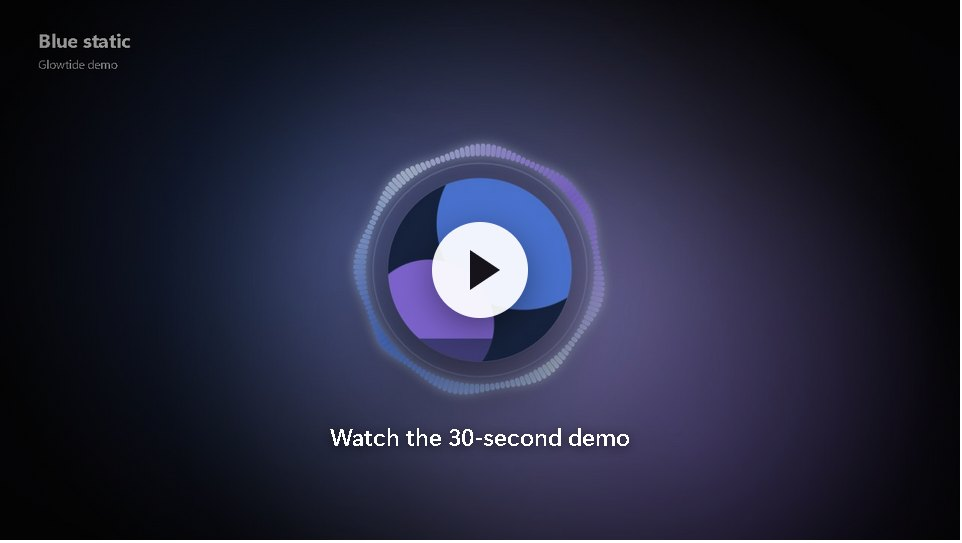

# Glowtide

**Your music, all around your screen.** Glowtide lights the edges of your screen in the colours
of the album cover and puts the lyrics on your desktop, word by word, as the song plays. It
works with **any music app** on Windows, with no setup.

[](https://github.com/cynicalk/glowtide-releases/releases/download/v1.0.12/glowtide-demo.mp4)

### [⬇ Download Glowtide for Windows](https://github.com/cynicalk/glowtide-releases/releases/latest)

Free and open source · Windows 10 and 11 · Updates itself

---

## Get started in a minute

1. **Download** `Glowtide-<version>-setup.exe` from the
   [latest release](https://github.com/cynicalk/glowtide-releases/releases/latest) and open it.
   It installs just for you, with no administrator prompt.
2. **If Windows says "Windows protected your PC"**, click **More info → Run anyway**. (The
   installer isn't code-signed yet, so Windows doesn't recognise it. That's all it means.)
3. **Play some music** in any app: Spotify, YouTube in your browser, Apple Music, anything.
   The glow and the lyrics follow along.

Glowtide lives in the **tray** by the clock. Closing its window just tucks it away there;
quit from the tray menu. It updates itself: when a new version is ready you'll see
**Restart to update**.

## What it does

### ✨ The edge glow

A soft light around the edges of your screen, in the colours of what's playing. It can
move with the music, keep clear of the taskbar, and use one or two colours from the cover.
It steps aside by itself while a game or a full-screen video is on.

### 🎤 Lyrics on your desktop

The song's lyrics float over your desktop, timed to the music, in seven styles:

| Style             | What it looks like                                                         |
| ----------------- | -------------------------------------------------------------------------- |
| **Stack**         | The word being sung, big in the middle                                     |
| **Karaoke**       | The line with a colour sweep across each word, and a 3-2-1 count-in        |
| **Constellation** | Each word lights a star and the line draws a real constellation in the sky |
| **Aura**          | The lyric over a soft, drifting cloud of the cover's colours               |
| **Waves**         | The line rides a ripple as each word lights up                             |
| **Beat**          | The word pulses with every beat                                            |
| **Messages**      | The lyrics arrive like a chat                                              |

Wrong or late lyrics? Nudge them earlier or later, pick another version, or tap along to
time them yourself. Glowtide can also notice lyrics running early or late and offer to fix
them with one click.

### 🗣️ Just say it

Open the command bar with **Ctrl+Alt+G** and type, or press **Ctrl+Alt+V** and speak:

- "Next song" · "Pause" · "Set the volume to forty" · "Go to one minute thirty"
- "Play Blinding Lights by The Weeknd" · "Add Levitating to the queue"

Songs come from Spotify when it's connected, and from **YouTube** when Spotify doesn't have the
song (or can't play it, as on a Free account). Typed searches show YouTube too: press Enter on
**Search YouTube for …**. Say "switch to Spotify" or "switch to YouTube" to change where songs
come from. YouTube songs are found with the official YouTube search when you've signed in with
Google, and otherwise (or once its daily allowance is used up) with YouTube Music's own search;
either way they play in YouTube's official player.

Turn on **"Hey Glow"** (Settings → App → Voice) and just say it, hands-free. The music
dips while you talk. Your voice is understood **on your PC**, and nothing you say is saved
or sent anywhere.

### 🖥️ Full screen

**Ctrl+Alt+F** turns your screen into a music display: the cover with a visualizer around
it (six styles), or the **album art filling the whole screen**. Press **B** to switch between
the two.

### 📊 Your listening

- **Stats:** hours listened, your top songs and artists, and a "My week in music" card.
- **Weekly recap** on Sunday evening, and **your year in music** in December.
- **On this day:** what you were playing this time last month or last year.
- **Favourite lines:** star a lyric line and share it as an image or an 8-second video clip.

Your history stays on your PC, and you can turn it off or clear it any time.

### 🎛️ Handy extras

- **Mini player** above the taskbar, by the clock.
- **Phone remote:** control the music and see the lyrics from your phone on the same Wi-Fi.
- **Quieter during calls:** the music goes down while you're on Discord, Teams, Zoom or a
  browser call.
- **Pauses when your headphones come out**, so nothing suddenly plays out loud.
- **Glow by time of day:** warmer and dimmer in the evening.
- **Your own background:** the blurred cover, flowing colours, or your own picture or video.
- **Backup:** move your whole setup to another PC with one file.

## Pick your music

| Source                    | Cost           | What you get                                                                                |
| ------------------------- | -------------- | ------------------------------------------------------------------------------------------- |
| **Any app** (recommended) | Free, no setup | Glowtide follows whatever is playing, with play, pause and skip where the app allows it     |
| **YouTube Music**         | Free           | Plays inside Glowtide. Paste any link, or sign in with Google for your playlists and search |
| **Spotify Premium**       | Premium        | Your library, playlists, search, queue and devices, controlled from Glowtide                |
| **Spotify Free**          | Free           | Glow, lyrics and colours follow along (Spotify doesn't allow remote control on Free)        |
| **Demo**                  | Free           | Built-in songs, to try every style without an account                                       |

Switch any time from Settings → Music source, or the tray icon.

<details>
<summary><b>Connecting YouTube (for your playlists and search)</b></summary>

Pasting a link needs no setup. To see your own library, you make a free Google Cloud
"client" once, about 5 minutes (Glowtide shows the steps too):

1. In [Google Cloud](https://console.cloud.google.com/), enable **YouTube Data API v3**.
2. Under **Google Auth Platform** (the OAuth consent screen), choose **External**, then in
   **Audience → Test users** add the Gmail you'll sign in with. Without this, Google blocks the
   sign-in ("can only be accessed by developer-approved testers").
3. Create an OAuth client of type **Desktop app**.
4. Paste its ID and secret in Glowtide's Library and sign in.

Google is only asked for read-only YouTube access.

</details>

<details>
<summary><b>Connecting Spotify</b></summary>

1. Create an app at <https://developer.spotify.com/dashboard> and choose **Web API**.
2. Add the redirect URI `http://127.0.0.1:43821/callback`.
3. Paste the Client ID in Glowtide and press **Connect Spotify**.

You sign in through your browser; there's no Glowtide server in between. Your sign-in is
stored encrypted by Windows on your PC.

</details>

## Keyboard shortcuts

| Anywhere       |                       | In full screen |                      |
| -------------- | --------------------- | -------------- | -------------------- |
| **Ctrl+Alt+G** | Command bar           | **Space**      | Play / pause         |
| **Ctrl+Alt+V** | Speak a command       | **← →**        | Previous / next song |
| **Ctrl+Alt+L** | Desktop lyrics on/off | **V** / **C**  | Visualizer / colours |
| **Ctrl+Alt+F** | Full screen           | **B**          | Album art background |
|                |                       | **L**          | Lyrics style         |
|                |                       | **Esc**        | Leave full screen    |

In the player: **Space** plays or pauses, **Ctrl+← →** skips, **Shift+← →** jumps 15 seconds,
**[ ]** nudges the lyrics 50 ms earlier or later, and **L** likes the song. Change or add global
shortcuts in Settings → App → Shortcuts.

## Your privacy

- **No account, no tracking, no Glowtide server.** Everything runs on your PC.
- **Voice** is understood on your PC by a speech model downloaded once (67 MB). Nothing you
  say is recorded, kept or sent anywhere. "Hey Glow" is off unless you turn it on; while
  it's on, Windows shows its microphone icon.
- **The beat** comes from your PC's sound output, never the microphone.
- **Your listening history** stays in your settings folder. Turn it off or clear it on the
  Stats page.
- **Sign-ins** (Spotify, Google) are stored encrypted by Windows, and the phone remote only
  lets in phones you've paired.

## Help

<details>
<summary><b>No lyrics for a song</b></summary>

Glowtide finds lyrics on [LRCLIB](https://lrclib.net) and the
[AMLL database](https://github.com/amll-dev/amll-ttml-db). If neither has the song, there's
nothing to show yet. If a song has lyrics but no timing, you can time it yourself: press
**Time these lyrics** under the lyrics and tap as each line starts.

</details>

<details>
<summary><b>The lyrics are early or late</b></summary>

Use **Sync** in the player (− / +), or **[** and **]**, to nudge them; Glowtide remembers it
per song. **Wrong lyrics?** under the lyrics shows other versions to pick from.

</details>

<details>
<summary><b>Glowtide doesn't hear me</b></summary>

- **Pick your microphone** in Settings → App → Voice → Microphone. **Automatic** uses Windows'
  default microphone but skips inputs like **Stereo Mix**, which record what the PC plays rather
  than your voice.
- **"Hey Glow"** is off until you turn it on (Settings → App → Voice). It needs Windows'
  English speech recogniser, which comes with the English (United States or UK) language pack:
  Settings → Time & language → Language & region.
- Check that Windows lets apps use the microphone: Settings → Privacy & security → Microphone.
- Over loud speakers, headphones or speaking closer to the mic help.

</details>

<details>
<summary><b>It doesn't see my music app</b></summary>

Glowtide reads the same "now playing" info as Windows' volume flyout and media keys. Almost
every app shares it; a few don't. If several apps are playing, choose which one to follow
under **Devices** (the speaker icon).

</details>

<details>
<summary><b>Where are my settings? How do I uninstall?</b></summary>

Settings live in `%APPDATA%\Glowtide` (with `glowtide.log`, if anything went wrong).
Uninstall from Windows Settings → Apps; your settings folder stays unless you delete it.

</details>

## Good to know

- **Spotify:** controlling playback needs Premium. Spotify limits apps like this one to 10
  search results per type, and to the songs of playlists you made yourself; other playlists
  still play.
- **YouTube:** some videos can't be played outside YouTube (Glowtide skips them, and the
  song's YouTube Music upload usually works). YouTube may show ads. It pauses while
  Glowtide's window is hidden, as YouTube's rules require. Each search uses 1% of your free
  daily allowance.
- **Word-by-word timing** comes from a community database of about 3,500 songs. For other
  songs the line timing is real and the word timing within a line is estimated (Glowtide
  says so).
- **Voice is English only**, and may mishear an unusual song or artist name.
- **No lock screen:** Windows doesn't let apps draw there.

---

<details>
<summary><b>For developers</b></summary>

### Build

```bash
npm install
npm run dev          # hot-reload
npm test             # unit tests
npm run build:win    # lint + tests + build, then the installer in dist/
npm run build:icon   # re-render build/icon.ico and the tray icon from scripts/build-icon.mjs
```

### Release

`npm run build:win`, then attach `Glowtide-<version>-setup.exe`, its `.blockmap` and
`latest.yml` from `dist/` to a full release (not a draft or pre-release) in
[`cynicalk/glowtide-releases`](https://github.com/cynicalk/glowtide-releases). Installed
copies update from whichever release is marked latest there, checking the download against the
SHA-512 in `latest.yml`; without `latest.yml` they can't see it.

### Debugging

These PowerShell variables work only in a development run (`npm run dev`, or `npx electron .`
after `npm run build`); a packaged copy ignores every one of them.

- `$env:GLOWTIDE_PROFILE="C:\somewhere"` uses a separate settings folder, so a test run never
  touches your real settings or closes the Glowtide you have open.
- `$env:GLOWTIDE_DEMO=1` starts in demo mode. `$env:GLOWTIDE_FRESH=1` resets settings.
- `$env:GLOWTIDE_SNAPSHOT="C:\shots"` writes each window's PNG and `state.json` after
  `GLOWTIDE_SNAPSHOT_MS` (default 6000), then quits. `$env:GLOWTIDE_PANEL="library"` opens a
  panel.
- `$env:GLOWTIDE_YT_TEST=<videoId>` switches to YouTube and plays that video.
  `$env:GLOWTIDE_SYS_TEST=<app id>` follows that app; add `GLOWTIDE_SYS_TEST_CMD="pause"` to
  send a command after 6 s. `$env:GLOWTIDE_DEBUG=1` logs player messages.
- `$env:GLOWTIDE_AUDIT=1` (with `GLOWTIDE_SNAPSHOT`, `GLOWTIDE_DEMO` and `GLOWTIDE_UNFOCUS`)
  clicks every button and changes every setting in the running app, checks each has its
  effect, writes `audit.json` and quits.
- `$env:GLOWTIDE_FS_TEST=1` (with `GLOWTIDE_SNAPSHOT`) logs, for 40 s, whether each overlay and
  widget is showing and the CPU of each window, into `fs.json`. `$env:GLOWTIDE_PERF=<seconds>`
  writes CPU and memory per window to `perf.json`.
- With `GLOWTIDE_SNAPSHOT`: `$env:GLOWTIDE_QUICK=1` opens the tray panel,
  `$env:GLOWTIDE_PLAYER_SIZE="1100,720"` sizes the player, `$env:GLOWTIDE_PLAYER_JS` runs in the
  player at 2.5 s, `$env:GLOWTIDE_HOVER="<selector>"` rests the pointer on an element (or in the
  tray panel, with `GLOWTIDE_HOVER_IN=quick`), `$env:GLOWTIDE_STAGE=1` opens full screen and
  `$env:GLOWTIDE_COMMAND=1` opens the command bar and keeps it open.
- `$env:GLOWTIDE_PROBE_JS="<js>"` (with `GLOWTIDE_SNAPSHOT`) runs in the lyrics overlay, or in
  the window `GLOWTIDE_PROBE_IN` names (`player`, `stage`, `command`, `mini`, `glow`), at
  `GLOWTIDE_PROBE_AT` ms (default 3000), and writes what it returns to `probe.json`.
- Voice without a microphone: start Electron with
  `--use-fake-device-for-media-stream --use-file-for-fake-audio-capture=<16 kHz .wav>` and the
  command bar hears that file. `$env:GLOWTIDE_WAKE_WAV=<.wav>` makes "Hey Glow" listen to
  a file.
- `$env:GLOWTIDE_PLAIN_TEST=1` (with `GLOWTIDE_DEMO`) serves the demo's lyrics untimed.
- `$env:GLOWTIDE_UPDATE_FEED="http://127.0.0.1:8899/"` updates a development run from a local
  folder of `latest.yml` and an installer (needs a `dev-app-update.yml`); add
  `GLOWTIDE_UPDATE_INSTALL=1` to install as soon as it has downloaded.
- **The demo video:** `$env:VITE_SHOWCASE=1; npx electron-vite build`, then a run with
  `GLOWTIDE_RECORD=1`, `GLOWTIDE_DEMO=1`, `GLOWTIDE_PROFILE` and `GLOWTIDE_SNAPSHOT=<folder>`
  draws six scenes offscreen into `<folder>/frames`, and
  `npx electron scripts/make-demo.cjs <folder> demo.mp4` adds captions and a soundtrack written
  in code. Build again without `VITE_SHOWCASE` afterwards.

### How it fits together

```
src/shared/    pure logic, unit-tested: lyrics parsing and timing, AMLL matching, colour,
               constellations, stats, voice commands, YouTube titles, media-session info
src/main/      Electron main: sign-in (PKCE), Spotify and YouTube, the media-session helper,
               LRCLIB, windows, tray, updates, voice (model download, wake word), phone remote
src/preload/   the window.glowtide bridge
src/renderer/  React: the player, the glow, the lyrics overlay, full screen, the command bar
scripts/       build-sky.mjs (constellation data from d3-celestial), build-icon.mjs (the icon)
resources/     smtc.ps1 (Windows media sessions), fullscreen.ps1 (spots full-screen apps)
```

**Light on the computer:** the glow and lyrics draw at 30 fps by default, everything that moves
continuously is moved by the GPU compositor rather than repainted, and the overlay stops all
work while it's hidden.

</details>

## Licence and credits

[MIT](LICENSE). Third-party code and data keep their own licences
([THIRD_PARTY_NOTICES.md](THIRD_PARTY_NOTICES.md)).

Lyrics are fetched while a song plays from [LRCLIB](https://lrclib.net) and the
[AMLL TTML DB](https://github.com/amll-dev/amll-ttml-db) (CC0), and kept only in memory or in your
own settings folder. None are stored in this repository; they belong to their songwriters and
publishers. Constellation figures come from [d3-celestial](https://github.com/ofrohn/d3-celestial)
© 2015 Olaf Frohn (BSD 3-Clause). Speech: [Moonshine](https://github.com/usefulsensors/moonshine)
by Useful Sensors (MIT), as converted by
[onnx-community](https://huggingface.co/onnx-community/moonshine-base-ONNX), run by
[transformers.js](https://github.com/huggingface/transformers.js) and ONNX Runtime Web.

Spotify, YouTube and YouTube Music are trademarks of their owners. Glowtide is not affiliated
with them.
